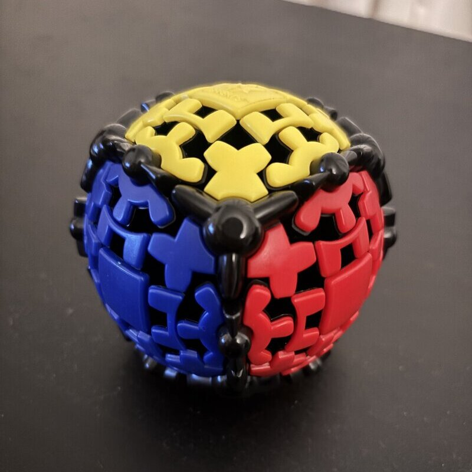
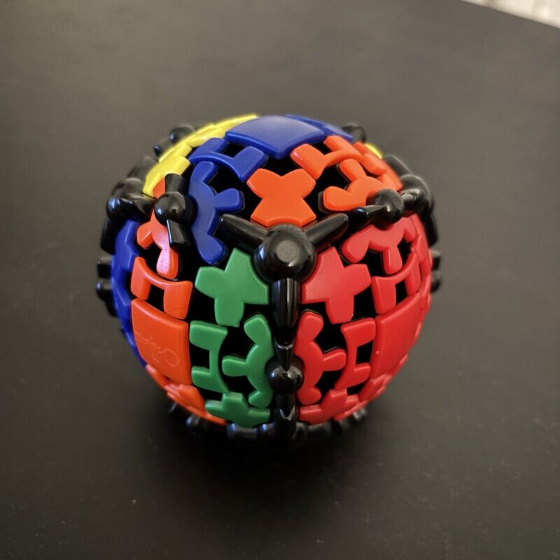

# Gear Ball
Some time ago I was gifted a Rubik's-like puzzle known as the Gear Ball (or sometimes [Meffert's Gear Ball](https://www.thecubicle.com/products/mefferts-gear-ball?srsltid=AU7gw4WyZ5dORPP-2_cs6hMFnZERNhoHYeIqRxR_KAz6QuoW)). It's an intriguing little device, and daunting the first time you turn it. With a simple tentative twist of one face, you suddenly find more than half of the ball writhing and spinning in your hand, seemingly under its own power.
As any good cuber (baller?) must, I vowed to conquer this puzzle. This post explains how I did that. First, some terminology and basics.

## Pieces
Here is what a solved Gear Ball looks like.

The Gear Ball has, like a 3x3 cube, three piece types, which I will call corners, centers, and hex-edges.
The first two are exactly identical to those of the 3x3 cube. Corners have three faces.
In the image above, right in the middle, you can see the yellow-red-blue corner (note that all those black bars are just sort of the "borders" of pieces, they aren't independently movable - ignore them).
Centers have one face, simple. In the image above, you can make out the yellow center at the top, the square piece (_not_ the U-shaped wings though - we will get to those).
You can also see the red and blue centers.
But the hex-edge is unique. It consists of three distinct parts: two U-shaped "wings", which can be thought of as akin to the faces of a normal edge; and a central hex-gear.
So in this image, for example, we can see the yellow-blue edge up at the left side of the image. It consists of _all_ of the following: the U-shaped yellow bit we will call a "wing", the half-yellow-half-blue hex-gear, and the U-shaped (upside-down U in this orientation) blue wing.
These three things are not separable, though the gear can rotate.
This image also clearly shows the yellow-red and blue-red edges.
I call the gear that is part of a hex-edge a hex-gear because it has 6 notches, and accordingly it has 6 possible states.
In its "solved" state the gear must be spun such that the colors of the gear match those of the wing pieces.

It is common to talk of pieces' "permutation" and "orientation" in cube puzzles. The former is simply position on the puzzle, and the latter is how a piece is twisted or flipped in its position.
A hex-edge has a third property, the rotational state of its gear. I will call this "spin". Proper/solved/good spin is spin 0.
Spin 1 is 1 notch clockwise (CW) from that position, i.e. you'd need to spin the gear 1 notch counterclockwise (CCW) to correct it. And so on for spin 2-5.
To be fully solved, a hex-edge must be in the proper position, with the proper orientation (defined by its wings), and with the proper spin.
We will find out later that spin is pretty easy to manipulate, so really when you are solving you are mostly looking at the wing pieces of a hex-edge.
Those are like the "anchors" of the piece, they tell you where it really is, while the spin is fluid and therefore unimportant.

So on the surface, a static Gear Ball appears to be like a 3x3 but with weird edges.
But what does it do in motion?

## Turning
Here is what a Gear Ball looks like after spinning the right face (the red face in this orientation) "once" (really "twice", see below).

Turning a face of a Gear Ball is a fun exercise, as it causes the gears to whirl into motion.
At first this seems quite complex, nearly half the ball has changed.
But eventually we can track down what is happening carefully.
For the purpose of explanation, let's consider this single R (again, really this was a double-move, keep reading) turn shown above (consult [standard 3x3 notation](https://en.wikipedia.org/wiki/Rubik%27s_Cube#Singmaster_notation)).
If you attempt to turn the right face 90 degrees CW, while holding the left face firm, you will find that the middle slice M starts to turn in the same CW direction, but at half-speed, as its gears mesh between the R and L faces.
This leaves the M slice 45 degrees offset, and thus the ball is in an "invalid" state.
I say invalid because you can't turn any other faces (other than continuing to turn R, or, equivalently, L).
You must continue the R turn further, completing 180 degrees (R2) to make the smallest possible valid turn. That is what the photo above shows, an "R2" move.

Since R2 is the "minimal" turn, from here on out, the notation R will be used to mean this 180 degree turn while holding the L face still (and similarly, moving U means rotating U 180 degrees holding D fixed, etc.).
That is, our new R is more similar to an R2 turn on a 3x3 cube, but there is no point in us calling it R**2** the whole time since every turn would be a "2".
It is simply an R. This, if I *do* write R2 after this point, I actually do mean 2 such R turns, i.e. a 360 degree turn (which is not a no-op!).

So what does a proper R turn do to the ball? First, to the right face, it does exactly what you'd expect.
The hex-edges and corners of the right face have all spun 180 degrees upside down.
You can see this in the photo. The gears of the right face's hex-edges do not engage in this move, they stay put (they move with their hex-edge, but they do not rotate themselves).

Where the strangeness happens is in the middle slice.
The middle slice is where the gears intermesh. As stated above, the middle slice rotates at half-speed compared to the right face, so it completes a 90 degrees CW turn (from the perspective of the right face).
The center that was previously on the front face is now on the up face. This bears repeating: basic turns on the Gear Ball move centers!
This will be an important fact to get used to. Similarly to the centers of the middle slice, the hex-edges of the middle slice are also moved 90 degrees CW around the ball, they are permuted.
But, due to the gear action, they all have non-zero spin applied too. All the hex-edges develop spin 1 (1 notch CW).
(Actually, during the R move the gears all perform a spin CCW 5 notches, but this fact is not really important, as the _result_ is a spin 1 notch CW.
The number 5 comes from the number of gear slots adjacent to the hex-edge in one face: 1 at the top of a corner piece, 1 between a corner piece and a wing piece, 1 in the center of a wing piece, 1 below the wing piece and above the bottom corner, and 1 below the bottom corner.
The hex-edge must pass all of these, intermeshing, and in doing so it rotates 5 notches. This is all not super important to understand, just as an aside.)
As outlined above, it's very important that an R turn means holding the L face still.
But it's already worth noting there is an alternate way you could look at this turn, as a half-R half-L turn.
If you twist both R and L in opposite directions at the same time, you can perform the same move while keeping the centers still.
This does the exact same thing to the ball, but it can come in handy depending on what the next move is, since this is a very smooth and natural motion. This will come into play later.

This all already raises some interesting questions and ideas:
 - What is the order of a base turn? (The number of times you need to repeat it to return to a solved state. On a 3x3 this is 4.) Well we know a single R turns the R face upside down, so the order must be a multiple of 2. We also know it moves the M slice forward 90 degrees. If we did R4, it should return the M slice centers and hex-edges to their original positions, and indeed it does. But this would give the hex-edges spin 4 (spin 1, applied 4 times). Adding another R4 brings all the pieces again back to the same, correct position but gives spin 2 to all the middle hex-edges (4 + 4 = 2 (mod 6)). And finally one more repetition of R4 returns spin 0 and solves the ball. So R12 - the order of R is 12. R6 and R'6 are equivalent, they do the same thing to the ball. This also reveals that we can manipulate the spin of all 4 hex-edges in a slice independently from everything else on the ball, in increments of two. That could come in handy later (it will).
 - The corners will be pretty constrained on the ball, just like the corners on a 3x3 in an R2F2U2 moveset (the states that can be reached on the 3x3 by only doing double moves). The corners can only be in a few different permutations, and they cannot be re-oriented.
 - The hex-edges also seem pretty constained, it is *almost* like a double-move set like the corners, but the middle slice moving a quarter-turn means that's not true. Still, as we will see later, the hex-edges do end up pretty constrained. This makes solving simpler.

## Solving
None of the above really helps much for solving yet. We've basically analyzed only one move and a "safe" repetition of it. To get an intuition for solving, in my opinion, one must simply dare to scramble up the puzzle and try to put things back together. Most types of puzzles have methods to solve them that begin with a "building" phase, where rote memorization of algorithms is not at all required. Instead, these phases focus on intuitive placement of pieces by straightforward means - slot this piece *here*, but whoops that messed up my other piece, ok then move that piece out of the way, slide this in, then restore...

When you start this process on the Gear Ball, mixing it up then trying to build say a cross like in CFOP, an interesting phenomenon concerning hex-edges immediately becomes evident. Edges that belong to the same slice are tightly coupled. If you insert, for example, the red-yellow hex-edge between the yellow and red centers (that is, the *wings* are oriented correctly, hex-spin does not matter here), you will find that somehow by magic the opposite hex-edge, the purple-yellow hex-edge, is also in the correct location and orientation on the other side of the yellow face. In fact, the entire slice's hex-edges will be positioned and oriented properly, including the orange-purple and orange-red hex-edges on the other side of the ball. Even more, all the hex-edges in this slice will have the exact same spin.

I do not yet have a great intuitive explanation for why this is. It clearly arises from the constraints inherent in how the ball can turn, but it's not obvious exactly how that arises. Nonetheless, it is certainly a fixed rule. This means that "solving" the cross on one face, say the yellow face, fully solves the permutation and orientation of two slices of the ball, leaving only the last slice, hex-spin on all slices, and the corners. Solving a cross is easy to do without algorithms (in the terminology from above, it is a "building" phase). And we covered above a method for adjusting the spin of an entire slice of the ball without affecting anything else (just repeating R many times in a row), but only by increments of 2. If hex-edge orientation always happens to be "off" by increments of 2, and if we can find algorithms for permuting the last slice's edges and the corners while preserving hex-spin, we should have a method for solving the entire ball. Indeed, I was able to generate such algorithms, leading to a full solution method we can call "slice-by-slice, then corners". I will lay out the exact solution method here, and then explain how the algorithms were generated, before some closing thoughts.

### Method
1. Slice 1. Pick a first slice to solve. We will take the slice common to the yellow-purple-orange-red centers. Take an edge of that slice, say red-yellow, and insert it into its correct location between the red and yellow centers with the correct wing-orientation, disregarding spin. This should take only a few moves. This will solve hex-edge position and orientation for this entire slice.
2. Slice 2. Pick a different slice to be the second slice to solve. We will take the yellow-blue-orange-green slice. Pick an edge of that slice, say blue-yellow. Attempt to insert it into its correct location between the blue and yellow centers. This, in general, is a little more tricky than step 1, as often inserting the hex-edge in such a way naively would mess up the first slice. But this step should also be doable in no more than a few moves, without algorithms, and I encourage you to play around with the ball a bit until you can accomplish this easily. The most straightforward way to do this is often to bring the edge to the "third" slice (here the red-green-purple-blue slice), then rotate the yellow face until the correct "slot" opens up under the hex-edge, insert it, then return the yellow face to its original orientation. That is, you have to do a little dance, move other pieces out of the way, then slot them back.
3. Spin. Spin can largely be fixed at any time after the first two steps, but now is a convenient time to do so since it turns out the later steps don't affect hex-spin. Orient slice 1 so that it is the M slice (between R and L). Inspect the spin of one hex-edge on the slice (they will all have identical spin). If it is spin 2 (it needs to be rotated CCW 2 notches to be fixed), do R4. If it is spin 4, do R'4. If the spin is correct, do nothing. (Luckily, odd spin numbers are impossible at this stage.) Note that an R4 operation can also be accomplished as an R2 and an L2 in unison, which may be easier to do. R4 is also equivalent to L4. All these operations will fix spin and do _nothing_ else. Once spin is fixed for slice 1, reorient so that slice 2 is at M and repeat. Again repeat for slice 3. After this, spin should be solved on the entire ball and won't need to be adjusted again as later steps do not affect spin.
4. Last slice. The last slice's hex-edges will be in one of three possible states.
  a. Solved, do nothing.
  b. Edges swapped "straight" along the same face. That is, each hex-edge needs to be moved 180 degrees to the opposite side of its face (*not* on the other side of the ball). To swap the FU hex-edge with the BU, and the FD with the BD, perform the algorithm `L U F' L' D' F`.
  c. Edges swapped to the opposite side of the ball. That is, each hex-edge needs to move to the complete other side of the ball, not along a face it is currently on. To swap the FU hex-edge with BD, and FD with BU, perform the algorithm `U L F U' R' x U'`. The (R' x) operation should be done in one smooth motion by turning R' and L' simultaneously, each halfway. This is done to make the last turn a U-based turn rather than a more awkward turn. Rather than doing this algorithm, you can also simply do the algorithm from b) twice, with a re-orientation in the middle.
5. Corners. At this point, everything on the ball will be solved except potentially the corners. If the corners are not solved, there will be two faces of the ball solved. Orient one of those faces so that it is facing you at F. Then do the algorithm `R' U R x' U R x' U' R' x U'`. Again, do the R-turns followed by x-turns as one smooth motion. After this step, the ball will be solved.

This generally is pretty easy for a solution method. The first two slices are a huge chunk of the ball and take only a few moves. Fixing spin is very simple. Only two algorithms are needed for solving the entire ball, and skips are relatively common. In all it might take seconds for a good solver to do this. Much of the "structure" just given almost for free.

## Generating algorithms
To generate algorithms, I built a model of the gear ball in Haskell. Modeling the pieces is simple, the only one with any intricacy is the HexEdge with its spin component. More difficult is modeling a turn operation, as it affects so much of the ball, including position of the center, spin, and the location of 17 separate pieces (well over half the ball). After this, I built an "algorithm finder" function, which takes as input a "goal" (move such and such pieces to these locations) with a "constraint" (a protected region of the ball that should remain undisturbed after the algorithm is complete) and does a very simple breadth-first search. This was planned to be just a starting point, I expected useful algorithms might be too long to find with such a simple and inefficient procedure, but this turned out not to be the case because many good algorithms are only 6 moves long.

The corner-fixing algorithms are 8 moves long, which is a little slow to find, but since those bring the ball to a known final state (fully solved), we can actually use "meet-in-the-middle" to drastically reduce the search space. The way this works is you take the starting state A and the desired state B (solved) and generate all possible states that are 1 move away from A and 1 move away from B independently, then look for a collision. If you find one, you have a 2 move algorithm for getting from A to B. If not, step up to 2 moves away, then so on. The reason this works well is that, at say 4 moves, the sum `number of possible states that are 4 moves away from A + number of states 4 moves away from B` is much less than `number of states 8 moves away from A`, since the search space grows more than linearly with number of moves.

Since only two/three algorithms are really necessary, generating algorithms was quite fast.

## Ergonomics
Turns on the gear ball are pretty awkward. R and L moves are the easiest, especially when done with the "half twist" procedure for combined moves like (R x'). U moves are probably next easiest, while D, F and B moves are not easy to do. Double moves are awkward in nearly all cases. To account for this, I built a simple "ergonomic score" method that penalizes these awkward moves. This allows for us to find potentially smoother algorithms, which is why the corner algorithm above is all R's U's and Rx operations - it is extremely fast.

## Closing ideas
In the end I was slightly disappointed by the simplicity of the solution method for the gear ball. I was able to effectively solve it in a single night's work. It seemed so complex at first sight that I wouldn't have expected this, but the constraints imposed by the requirement of 180-degree turns apparently outweighs the perceived complexity. Hex-spin being easily fixable in isolation does not help add complexity either. Still, this is a fun and imaginative puzzle, and its best and most genius element is the gearworks. I have no idea how one could have thought of putting gears on a cube in this manner, and made it work so smoothly, it really is a beautiful construction.

The slice-by-slice then corners solution method was the first method that I seriously tried and ended up being a very good one. But we can take a moment to speculate on other solution ideas. The constraints that the corners are placed under (no orientation changes, no 3-cycles) means a layer-by-layer approach is not really possible in a classic sense - solving one layer means everything but the middle slice is solved. What one might try is a corners-first approach, but this seems awkward since it leaves 12 hex-edges unsolved that will require algorithms to fix, so the "algorithmic" stage of the method affects 12 pieces instead of 8, and spread out over the entire ball. "Recognition", a cubing phrase meaning determining what algorithm to apply, becomes harder when you have to search multiple parts of the ball like this.

We can also think about modifications to the steps of the given method. Some that jump out to me:
 - Influencing spin at various stages. Spin for the last slice might be solvable at the same time as permutation by simply injecting an extra R2/L2 into the algorithms. If done at the right place, this could leave the number of moves the same, or at least save moves overall. Spin could also be influenced during the solution for slice1/2 in non-algorithmic ways. The simplest idea for that is, in a situation where solving slice 2 involves slotting the edge with a final R, it might be useful instead to do an R'3 to fix spin on the middle slice. I bet it may even be possible to fix spin everywhere, or at least on the first two slices, in a free-form manner like this.
 - Combining algorithmic steps. Since the final two steps are each so simple and have so few algorithms and cases, we could try to combine the two into one algorithm stage. Recognition for this would be a little tricky. I ended up finding algorithms for the 9 states here. None are longer than 8 moves. Again, recognition is really the hardest part.

All the code for this project and more information can be found at https://github.com/conor-mcavoy/gear-ball .

Thank you to my dear friend Seiji for gifting me this puzzle.
